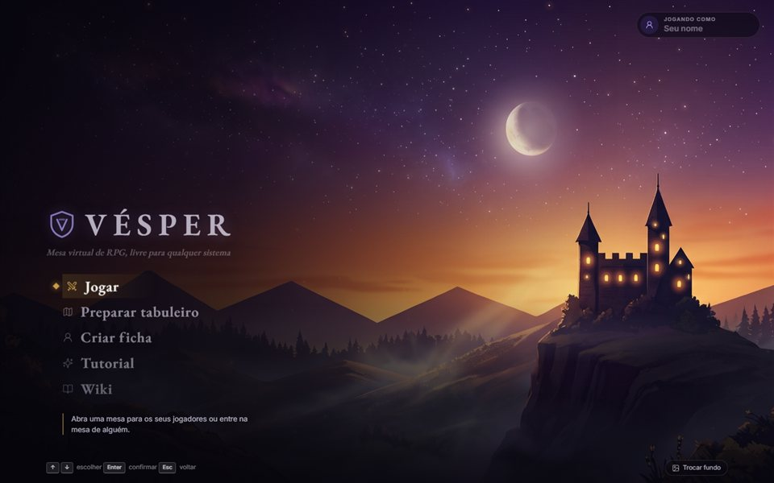
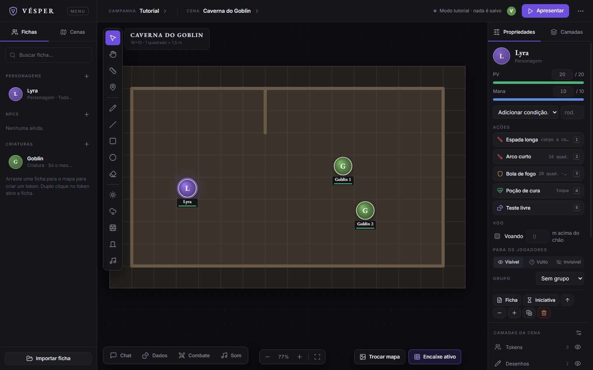

# Vésper · mesa virtual de RPG

Mesa de RPG que roda direto no navegador, para jogar com os amigos em qualquer sistema (D&D, Tormenta, Ordem Paranormal, o seu próprio…).
Sem conta, sem servidor e sem instalar nada: o computador do mestre faz o papel de servidor, e os jogadores entram com um código.



## Como abrir

1. Baixe o projeto (botão **Code → Download ZIP**, ou `git clone`).
2. Abra o `index.html` no **Chrome** ou no **Edge**.

> Recomendado: rodar um servidor local na pasta (`npx serve .` ou a extensão *Live Server* do VS Code). Funciona melhor que abrir o arquivo direto.

## Como jogar

| Quem | O que fazer |
|---|---|
| **Mestre** | Escreva seu nome no canto de cima → **Jogar → Abrir mesa online**. Aparece um código de 6 letras (ex.: `K7QX2M`). Mande para os jogadores. |
| **Jogadores** | Escreva seu nome → **Jogar → Entrar na mesa online** → digite o código. |

O mestre precisa deixar a aba aberta durante a sessão. Se ele recarregar a página, os jogadores reconectam sozinhos.

**Primeira vez?** No menu inicial, escolha **Tutorial**: é a mesa de verdade, com uma cena de exemplo e um guia que mostra onde clicar. Nada é salvo.
Para consultar depois, use a **Wiki** (manual com fotos e exemplos, em [wiki/index.html](wiki/index.html)).



## O que dá para fazer

- **Mapas e cenas:** envie a imagem do mapa, ajuste o grid e crie várias cenas. Dá para separar um ou mais jogadores numa cena só deles.
- **Imagens no mapa:** solte baús, árvores, fogueiras e armadilhas no mapa; mova, gire, redimensione, esconda dos jogadores e escolha quem fica por cima (imagens e tokens dividem os mesmos níveis).
- **Mostrar aos jogadores:** prepare cartas, retratos e pistas (imagem, texto ou os dois) e, na hora, abra na tela de todos ou de jogadores escolhidos.
- **Fichas livres:** atributos, barras (PV, Mana…), ações com fórmulas de dados e anotações. Personagens, NPCs e criaturas.
- **Combate automático:** escolha a ação, clique no alvo e o sistema rola ataque × defesa, aplica o dano e mostra o resultado no mapa. Alcance, áreas de magia, críticos, iniciativa e turnos.
- **Movimento por caminho:** arrastando o token, o botão direito marca pontos de passagem; a régua mostra cada trecho e o total, e todos veem o rastro.
- **Dados:** `2d6+3`, vantagem `2d20kh1`, `4d6dl1`, dado explosivo `1d6!`, `@forca` puxa o atributo da ficha.
- **Luz e visão:** os jogadores só veem o que está iluminado e à vista, em três níveis (luz plena, meia luz e escuridão). Tochas e lanternas em cone com cor, visão no escuro, portas e névoa de guerra. Pontos de luz no mapa (círculo, cone ou área, com cor e tremor) e pontos de escuridão.
- **Paredes e cobertura:** parede absoluta, cobertura total, três quartos (+5) e meia (+2). A altura de cada criatura conta, e criaturas podem voar.
- **Tokens:** visível, vulto (só uma silhueta para os jogadores) ou invisível, e grupos para mudar vários de uma vez.
- **Música e sons:** música e ambiente para todos, sons presos a um ponto do mapa e salas de som com música própria.
- **Duas visões:** o mestre controla tudo; os jogadores só vivem a história. O mestre pode ver a mesa como um jogador.
- **Salvar:** automático no navegador, e exportar a campanha num arquivo `.json` como backup.

## Sons

A pasta `Sons/` vem **vazia** (os arquivos de áudio não ficam no repositório). Coloque suas músicas nela:

```
Sons/
  musicas/    trilhas (taverna, batalha…)
  ambiente/   chuva, vento, caverna…
  Efeitos/    porta, trovão, espada…
```

Na mesa, abra **Som** (embaixo) → **Escolher pasta** e escolha a pasta `Sons`. Os jogadores recebem as faixas pela própria conexão da mesa; eles não precisam ter os arquivos.

## Para quem quer mexer no código

HTML, CSS e JavaScript puro, sem build. A conexão entre jogadores usa [PeerJS](https://peerjs.com) (WebRTC).

```
index.html     menu inicial e layout da mesa
css/style.css  visual
js/store.js    estado da mesa e regras de permissão (o coração do sistema)
js/ui.js       painéis, fichas, combate, cenas
js/board.js    o mapa (canvas)
js/combat.js   alcance, cobertura, chance de acerto
js/light.js    luz e visão
js/audio.js    música e sons
js/dice.js     rolador de dados
js/net.js      conexão entre mestre e jogadores
js/tutorial.js passos do tutorial
wiki/          manual
```

Toda mudança na mesa é uma ação (ex.: `{ type: 'token.move', … }`) aplicada em `js/store.js`. O mestre confere o que cada jogador pode fazer em `permit()` e repassa para todos.
